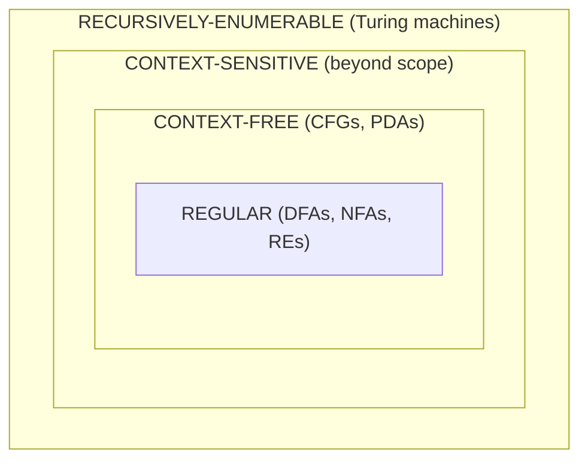

The **Chomsky hierarchy** is a ladder of language classes, each strictly containing the one below it. Every level has two kinds of description: a **machine** that *recognizes* strings, and an **expression or grammar** that *generates* them.

*The hierarchy as nested classes (Lecture 8, slide 6)*

| Language class | Automaton-based (recognizes) | Expression-based (generates) |
|---|---|---|
| Regular | DFA / NFA | Regular expression |
| Context-free | [[Pushdown Automaton]] (Lecture 9) | [[Context-free Grammar]] (Lecture 8) |
| Context-sensitive | Linear bounded automaton *(not studied)* | Context-sensitive grammar *(not studied)* |
| Recursively enumerable | Turing machine *(later)* | Unrestricted grammar *(not studied)* |

**Reading the table**
- Each row is one level of descriptive power
- For the first row the two columns are equivalent — that was [[Kleene's Theorem]] (Lecture 6). For the second row, [[Equivalence of PDAs and CFGs]] (Lecture 9) is the analogue
- The rows are **strictly nested**: {0ⁿ1ⁿ} lives in the context-free row but, by [[Non-regularity of 0n1n|Lecture 7]], not in the regular one — so REG ⊂ CFL ([[Regular Languages are Context-free]])
