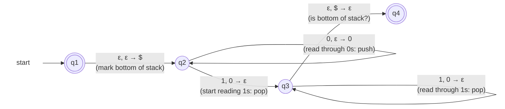

A [[Pushdown Automaton]] recognizing L = {0ⁿ1ⁿ : n ≥ 0} — the language no DFA can recognize ([[Non-regularity of 0n1n]]). The plan:
1. Mark the bottom of the stack ([[Bottom-of-Stack Marker]]) so we'll know when we reach it
2. Push every 0 onto the stack
3. As soon as a 1 appears, pop one item for each 1
4. If the stack is empty (\$ on top) upon the last 1, the 0s and 1s were equal — accept

> [!tip] The invariant — one sentence explains the whole machine
> **At every moment, the stack holds exactly the unmatched 0s (with \$ beneath them).**
> - Reading a 0: one more unmatched 0, so push it
> - Reading a 1: it matches the most recent unmatched 0, so pop it
> - Accept exactly when \$ resurfaces at the right moment: every 0 found its 1
>
> Same discipline as the grammar A → 0A1 ([[CFG for 0n1n]]): the 0 and the 1 pair up — there at birth, here by push and pop.

*The machine, in transition notation (slides 24–25)*

q1 and q4 are accept states.

### Trace on 0011

| step | state | remaining | stack | transition used |
|---|---|---|---|---|
| 0 | q₁ | 0011 | (empty) | |
| 1 | q₂ | 0011 | \$ | ε, ε → \$ |
| 2 | q₂ | 011 | \$0 | 0, ε → 0 |
| 3 | q₂ | 11 | \$00 | 0, ε → 0 |
| 4 | q₃ | 1 | \$0 | 1, 0 → ε |
| 5 | q₃ | ε | \$ | 1, 0 → ε |
| 6 | q₄ | ε | (empty) | ε, \$ → ε |

Input consumed, q₄ ∈ F: **accept**. The stack grew to two unmatched 0s and shrank back — the invariant, animated.

### The three failure modes

| Input | Kind | Where and why it dies |
|---|---|---|
| 001 | more 0s | after 0, 0, 1 the run sits in q₃ with stack \$0 and no input left. q₃ ∉ F, and ε, \$ → ε can't fire (top is 0). Stuck — the leftover 0 is the witness |
| 011 | more 1s | after 0, 1 the run is in q₃ with stack \$. The second 1 needs 1, 0 → ε but the top is \$. The branch that jumps to q₄ still holds unread input, and q₄ has no outgoing edges. Every branch dies |
| 10 | wrong order | in q₂, input 1 with top \$: 1, 0 → ε needs a 0. Dead immediately |

### The two short inputs

> [!question] Does the machine accept ε? Does it accept 0?
> **ε — yes.** Branch one: stay in q₁; input already consumed and q₁ ∈ F — accept. Branch two: move to q₂ pushing \$; q₂ ∉ F, so that branch doesn't accept. One accepting branch suffices: ε ∈ L, matching n = 0. **This is why q₁ must be an accept state.**
> **0 — no.** The only live branch reaches q₂ with stack \$0 and no input left; q₂ ∉ F, and neither the q₂ loop nor 1, 0 → ε can fire. No branch accepts.
>
> The one-sided rule is the NFA rule of Lecture 4, unchanged: branches that die cost nothing; a single success decides. See [[PDA Configuration]].
