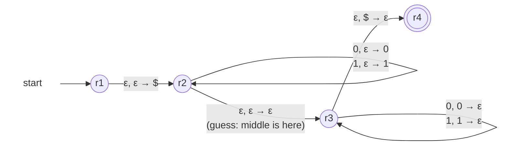

A [[Pushdown Automaton]] for L = {wwᴿ : w ∈ {0,1}\*} — even-length strings whose second half is the first half reversed (e.g. 0110, 001100; the even half of the [[Palindrome Language]]).

A stack pops in reverse order of pushing — exactly the mirror. The difficulty: **how does the machine know where the middle is?** It doesn't. **It guesses**, with an ε-move.

*Push phase, guess the middle, match phase (slide 39)*

- **Phase r₂**: push every input symbol. The silent jump r₂ → r₃ is the guess "the middle is here"
- **Phase r₃**: match each input symbol against the top and pop. The stack replays the first half backwards — exactly wᴿ
- **Accept** when \$ resurfaces at the end of the input

### Every guess on 0110

The jump can fire after 0, 1, 2, 3 or 4 symbols — five branches:

| jump after | stack at the jump | what happens next |
|---|---|---|
| 0 symbols | \$ | input 0 vs top \$: dead |
| 1 symbol | \$0 | input 1 vs top 0: dead |
| 2 symbols | \$01 | 1 matches 1, 0 matches 0, \$ up: **accept** |
| 3 symbols | \$011 | input 0 vs top 1: dead |
| 4 symbols | \$0110 | nothing left to match; top is 0, not \$: dead |

Four branches die, one survives — and one is all the definition asks ([[PDA Configuration]]). The machine "finds the middle" by trying every middle at once. This nondeterminism cannot be removed: see [[Nondeterminism in PDAs]].
