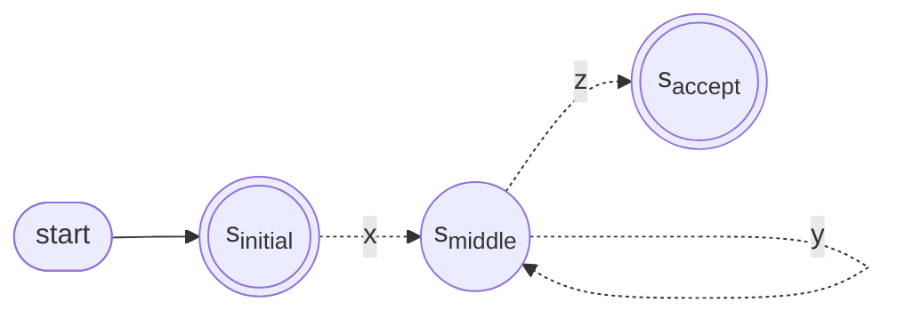

> [!note] Theorem 4 — Pumping Lemma
> If L is a [[Regular Language|regular language]], then there is a number p (the **pumping length**) such that every string s ∈ L with |s| ≥ p can be divided into three parts s = xyz where:
> 1. xyⁱz ∈ L for every i ≥ 0
> 2. |y| > 0 — y has non-zero length
> 3. |xy| ≤ p — x and y together are no longer than the pumping length

In words: every sufficiently long string in a regular language contains a substring that can be repeated arbitrarily many times (or dropped) without leaving the language. It is a property *every* regular language has — so a language that lacks it is [[Non-regular Language|non-regular]], which is what the lemma is used for.

**The statement, quantifier by quantifier.** If L is regular, then

∃ p such that ∀ s ∈ L with |s| ≥ p, ∃ a split s = xyz (with |y| > 0 and |xy| ≤ p) such that ∀ i ≥ 0 : xyⁱz ∈ L

- **p exists but is unknown to us** — it comes from the (hypothetical) machine
- **The split xyz is not ours to choose** either — the lemma only promises that *some* split works
- What the lemma quantifies over *all* of: long strings s, and repetition counts i

That alternation is why a proof is best run as the [[Pumping Lemma Game]].

**The idea — looping through an automaton.** Any string s ∈ L defines a computational path through the automaton. Suppose that automaton is a DFA with p states. Feed it a string of length p or more: by the [[Pigeonhole Principle]] at least one state is visited more than once, so the path contains a loop — and if there is a loop, we can build strings that go round it as many times as we like.

**Watch it hold once, inside a regular language.** L = strings of even length; its DFA has p = 2 states, A and B.
- Take s = 0101. The computation visits A, B, A, B, A — state A repeats after two symbols, as pigeonhole promised
- The loop reads y = 01, giving the split x = ε, y = 01, z = 01
- Pump: xy⁰z = 01, xy¹z = 0101, xy²z = 010101, … — every one has even length. All in L, exactly as the lemma asserts

**Why "pumping".** Pumping up a string is like inflating a balloon: the middle portion y can be repeated arbitrarily many times and the result is still in the language. Underneath it is still looping — "looping lemma" might be the better name.

*The three parts of a long string's computational path — y starts at s_middle and returns to it (slide 20)*

x reaches the repeated state, y goes once round the loop, z continues on to the accept state. Going round i times reads xyⁱz and ends in the same place.

> [!note] About the picture
> The slide draws s_initial with a double circle, like s_accept. Nothing in the argument needs the start state to be accepting — read it as "wherever the computation begins". The arrows are dashed because each stands for a whole stretch of the path, not a single transition.

**Why the two side conditions hold**
- **|xy| ≤ p** — within the first p input symbols the computation occupies p + 1 states, so a repeat already occurs among them. The loop closes by then
- **|y| > 0** — a loop traverses at least one transition, and every transition of a [[Deterministic Finite Automaton|DFA]] reads a symbol, so y contains at least one symbol

> [!tip] Both conditions are weapons for you
> Condition 3 confines y to the *front* of your string (the [[Condition-3 Shortcut]]); condition 2 guarantees pumping actually changes it.

> [!warning] One direction only
> Regular ⇒ pumpable. The lemma can show a language is *not* regular, never that it is — see [[Limits of the Pumping Lemma]].

If the lemma feels complicated (and it kind of is), the deck recommends the blog post [I hate the Pumping Lemma](https://bosker.wordpress.com/2013/08/18/i-hate-the-pumping-lemma/).
