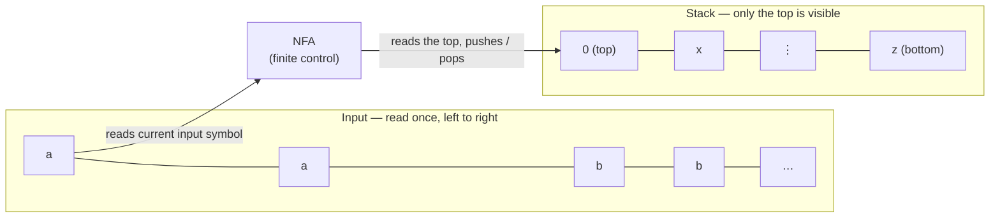

A **pushdown automaton (PDA)** is essentially a [[Non-deterministic Finite Automaton]] with the added ability to read and write a **stack**. Each time it reads an input symbol it can also read the top of the stack and do a stack operation. It is the machine side of context-free: where a [[Context-free Grammar]] *generates* a [[Context-free Language]], a PDA *recognizes* one.

*The architecture: finite control, input, stack (Lecture 9, slides 6–7)*

**Three components**
- A **finite control** — the familiar state diagram, still finitely many states
- The **input**, read once, left to right, as in every automaton so far
- New: a **stack** — unbounded storage with a strict discipline: push on top, pop from the top, only the top symbol is ever visible

This is the stack ADT from data structures, used as machine memory. The discipline *is* the point: unbounded capacity, but last-in-first-out access only. Lecture 9 shows what it makes possible; Lecture 10 asks what remains impossible.

> [!note] Definition 1 — Pushdown Automaton
> A PDA is a 6-[[Tuple]] **(Q, Σ, Γ, δ, q₀, F)**:
> 1. **Q** — finite set of states
> 2. **Σ** — input [[Alphabet]]
> 3. **Γ** — stack alphabet
> 4. **δ : Q × Σε × Γε → 𝒫(Q × Γε)** — transition [[Function]]
> 5. **q₀ ∈ Q** — start state
> 6. **F ⊆ Q** — set of accept states

**What changed since the NFA**

| | NFA (Lecture 4) | PDA |
|---|---|---|
| components | (Q, Σ, δ, q₀, F) | (Q, Σ, Γ, δ, q₀, F) |
| new alphabet | none | Γ: stack alphabet |
| transition reads | state, input-or-ε | state, input-or-ε, top-or-ε |
| transition yields | a set of states | a set of (state, push-or-ε) |
| accepts when | input done, state in F | input done, state in F |

- Γ may differ from Σ: the \$ [[Bottom-of-Stack Marker]] is a stack symbol that never occurs on input
- The power set 𝒫(·) is still there: **a PDA is nondeterministic by definition** (and here it matters — see [[Nondeterminism in PDAs]])
- **Acceptance does not mention the stack**: finish the input in an accept state, whatever the stack holds

> [!question] Reading δ : Q × Σε × Γε → 𝒫(Q × Γε)
> 1. What do the two ε subscripts on the left permit?
> 2. What does it mean when δ returns the empty set?
> 3. Where in this signature is the nondeterminism?
>
> Answers — **1.** Σε: move without consuming input (as in an NFA). Γε: move without looking at or popping the stack. **2.** No move is available — that branch halts and dies. **3.** In the codomain: 𝒫(Q × Γε) is a *set of options*. Several = branching; one = a forced move; none = death. The Γε on the right is the symbol pushed (or ε for nothing).

Edges are labelled with [[PDA Transition Notation]]; runs are traced as [[PDA Configuration|configurations]].
