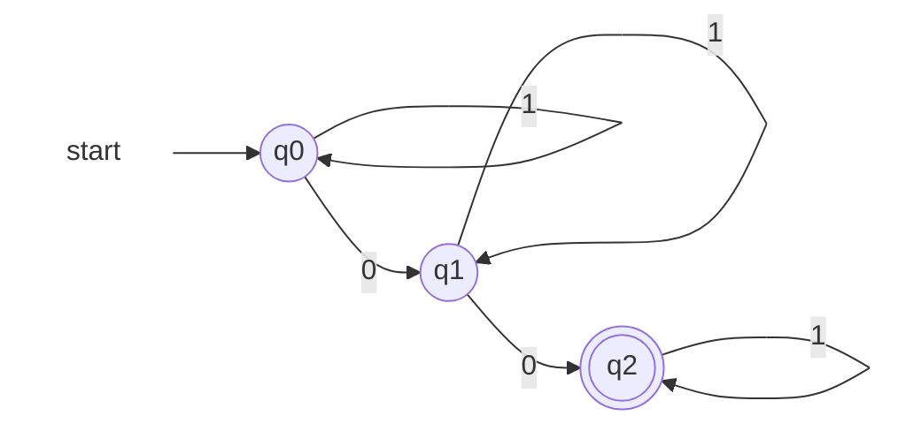

> [!note] Theorem 3
> Every [[Regular Language|regular language]] is a [[Context-free Language|context-free language]].

A language is regular iff some DFA recognizes it, and context-free iff some CFG generates it — so it suffices to show **every DFA has an equivalent CFG**.

**DFA → CFG conversion**
- Every state qᵢ ∈ Q becomes a variable **Qᵢ**
- Every symbol s ∈ Σ becomes a terminal
- Every transition qᵢ × s → qⱼ becomes a rule **Qᵢ → sQⱼ**
- The start state q₀ becomes the start variable **Q₀**
- Every accept state q_f ∈ F contributes a rule **Q_f → ε**

**Why it works.** Read Qᵢ as the statement "the machine is currently in state qᵢ."
- A derivation always has the shape s₁s₂⋯sₖ Qᵢ — the letters consumed so far, then the current state, always at the right end
- One application of Qᵢ → sQⱼ *is* one transition: consume s, move to qⱼ
- Q_f → ε says the derivation may terminate exactly where the run may accept

So derivations and accepting runs correspond one to one, and the two describe the same language.

### Worked example

*The DFA to convert (Lecture 8, slide 39)*



The conversion yields:
```
Q0 → 1Q0 | 0Q1
Q1 → 1Q1 | 0Q2
Q2 → 1Q2 | ε
```

It describes **all strings over {0,1} containing exactly two 0s** — as an RE, 1\*01\*01\*. Run and derivation on 1001, side by side:

| DFA run | Derivation |
|---|---|
| start in q₀ | Q₀ |
| read 1: stay in q₀ | ⇒ 1Q₀ |
| read 0: move to q₁ | ⇒ 10Q₁ |
| read 0: move to q₂ | ⇒ 100Q₂ |
| read 1: stay in q₂ | ⇒ 1001Q₂ |
| q₂ ∈ F: accept | ⇒ 1001 (by Q₂ → ε) |

The derivation **is** the run, written as text: same states, same letters, same order.

> [!tip] Grammars aren't unique
> For L = {w : w ends in 01}, writing a grammar directly gives **S → 0S | 1S | 01** (emit leading symbols one at a time, close with the mandatory suffix; e.g. S ⇒ 1S ⇒ 11S ⇒ 1101). Nothing extra: the last rule is always S → 01. Nothing missing: for w = u01, spell out u then finish with S → 01. Converting the Lecture 3 DFA instead gives a different, larger grammar for the same L.

Lecture 9 proves the same inclusion on the machine side: an NFA is just a [[Pushdown Automaton|PDA]] that never touches its stack.
