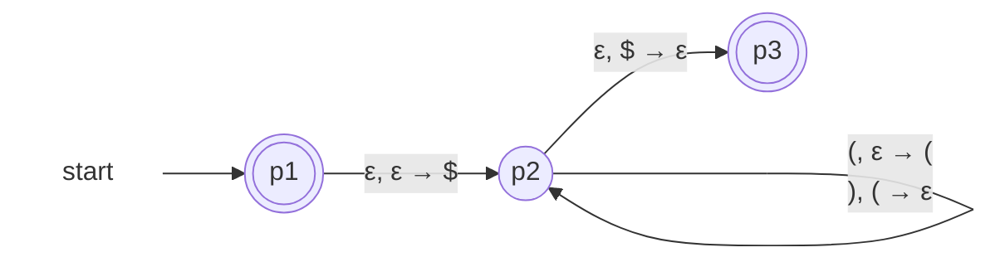
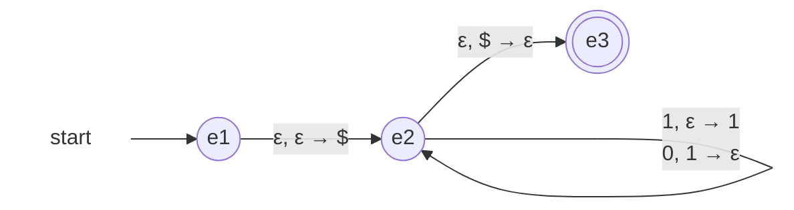
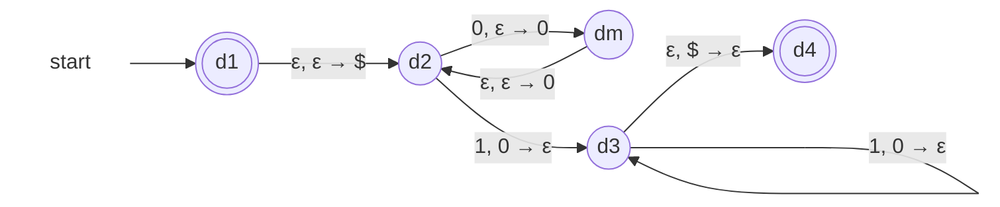
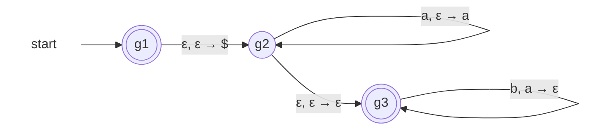

# Lecture 9 — Pushdown Automata

Monday, October 19. Lecture 8 gave the generating side of context-free: grammars, with {0ⁿ1ⁿ} as the witness that REG ⊂ CFL. Today the machine side: the pushdown automaton, a finite automaton plus a stack — its formal definition, transition notation, fully worked machines, and the theorem that closes the loop: PDA-recognizable = context-free. The question for the day: a DFA could not recognize {0ⁿ1ⁿ} — what exactly must be added so that a machine can?

> [!info]- Slide index — where each section comes from
> | Section of this note | Slides in the deck |
> |---|---|
> | *Review and outline* | 2 Review, and Today's Outline · 4 Introduction · 5 Remark: Where Today Fits |
> | **The Machine** | 3 *part divider* |
> | ⤷ `Pushdown Automaton` | 6 Pushdown Automata 📊 · 7 Pushdown Automata 📊 · 8 Remark: The Architecture · 11 Pushdown Automaton Definition · 12 Remark: What Changed Since the NFA · 13–14 Question: Reading the Definition |
> | ⤷ `PDA Transition Notation` | 15 Pushdown Automaton Notation · 16 Remark: Interpreting the Label a, b → c · 17 Pushdown Automaton Notation · 18 Pushdown Automaton: The Stack · 19–20 Exercise: Writing Transition Labels · 49–50 Additional Exercise: {0ⁿ1²ⁿ} (note) |
> | ⤷ `Bottom-of-Stack Marker` | 9–10 Exercise: Elementary Stack Operations · 20 Exercise: Writing Transition Labels (note) · 21 Remark: Why Push the \$ at All |
> | **Example 1: {0ⁿ1ⁿ}** | |
> | ⤷ `PDA for 0n1n` | 22 PDA Example 1 · 23 Remark: The Invariant of Example 1 · 24 PDA Example 1 📊 · 25 PDA Example 1 📊 · 26–27 Exercise: Tracing 0011 · 28–29 Exercise: Three Rejections · 30–31 Question: The Two Short Inputs · 32 Example 1: Sanity check |
> | ⤷ `PDA Configuration` | 33 Remark: Configurations and Halting Branches |
> | **More Machines** | |
> | ⤷ Exercise: Balanced Parentheses | 34–35 Exercise: A PDA for Balanced Parentheses 📊 · 36–37 Exercise: Tracing (()) |
> | ⤷ `PDA for wwR` | 38–39 Exercise: A PDA for {wwᴿ} 📊 · 40–41 Exercise: Every Guess on 0110 |
> | ⤷ `Nondeterminism in PDAs` | 42 Remark: Nondeterminism Is Essential Here |
> | **PDAs and CFGs** | |
> | ⤷ `Equivalence of PDAs and CFGs` | 43 Equivalence of PDAs and CFGs (Theorem 2) · 44 Remark: Consequences of the Theorem · 46 Question: Which Machine Suffices? (note) |
> | ⤷ Question: Which Machine Suffices? | 45–46 Question: Which Machine Suffices? |
> | **Additional Exercises** | |
> | ⤷ Equally Many 0s and 1s | 47–48 Additional Exercise: Equally Many 0s and 1s 📊 |
> | ⤷ {0ⁿ1²ⁿ} | 49–50 Additional Exercise: {0ⁿ1²ⁿ} 📊 |
> | ⤷ At Least as Many as | 51–52 Additional Exercise: At Least as Many as 📊 |
> | *Review Questions* | 53–54 Review Questions |
> | **This Week** | 55 This Week |
> | *Summary and Next Steps* | 56 Summary and Next Steps |

## The Machine

![[Pushdown Automaton]]

![[PDA Transition Notation]]

![[Bottom-of-Stack Marker]]

## Example 1: {0ⁿ1ⁿ}

![[PDA for 0n1n]]

![[PDA Configuration]]

## More Machines

### Exercise: Balanced Parentheses

Design a PDA for Lecture 8's [[Balanced Parentheses Grammar|balanced-parentheses grammar]] S → (S) | SS | ε, in the spirit of Example 1. **The stack holds exactly the currently open parentheses.**

*PDA for balanced parentheses (slide 35)*

- Reading **(**: one more open bracket, so push it. Reading **)**: it closes the most recent open bracket, so pop it
- A ) with \$ on top means "closing a bracket never opened" — the branch dies (Lecture 8's first failure mode)
- Leftover (s keep the \$ buried, so the jump to p₃ never fires (the second failure mode)

**Trace on (())**

| step | state | remaining | stack | transition used |
|---|---|---|---|---|
| 0 | p₁ | (()) | (empty) | |
| 1 | p₂ | (()) | \$ | ε, ε → \$ |
| 2 | p₂ | ()) | \$( | (, ε → ( |
| 3 | p₂ | )) | \$(( | (, ε → ( |
| 4 | p₂ | ) | \$( | ), ( → ε |
| 5 | p₂ | ε | \$ | ), ( → ε |
| 6 | p₃ | ε | (empty) | ε, \$ → ε |

The stack height over time is the nesting depth of the string: 0, 1, 2, 1, 0. The machine is the depth counter.

![[PDA for wwR]]

![[Nondeterminism in PDAs]]

## PDAs and CFGs

![[Equivalence of PDAs and CFGs]]

### Question: Which Machine Suffices?

Name the weakest machine class that recognizes each language, with a one-phrase justification.

| Language | Weakest machine | Why |
|---|---|---|
| L₁ = {s : s ends in 01} | DFA | regular — needs no counting |
| L₂ = {0ⁿ1ⁿ : n ≥ 0} | PDA | context-free but not regular (Lecture 7), so no finite automaton suffices |
| L₃ = {wwᴿ : w ∈ {0,1}\*} | PDA | same status: pumping with s = 0ᵖ110ᵖ rules out every DFA, and [[PDA for wwR]] recognizes it |
| L₄ = {s : \|s\| is even} | DFA | two states track the parity of the length |

## Additional Exercises

### Equally Many 0s and 1s

L = {s ∈ {0,1}\* : s has equally many 0s and 1s}, order arbitrary (0110 ∈ L, 1100 ∈ L). **Let the stack hold the current surplus** — whichever symbol is ahead, and by how much. One working state; the stack never mixes 0s and 1s.

*PDA for equal 0s and 1s (slide 48)*

- **Why it's correct:** an accepting run ends with bare \$, so every push is later popped. A pushed 0 is popped only by a 1, a pushed 1 only by a 0, so the run pairs the symbols off perfectly — forcing equal counts. Conversely, for any balanced string, the run that always cancels against a nonempty surplus accepts
- Branches that push when they "should" cancel die before the \$ can resurface — nondeterminism, harmless as ever

### {0ⁿ1²ⁿ}

L = {0ⁿ1²ⁿ : n ≥ 0}: twice as many 1s, zeros first. A single transition pushes at most one symbol — so how can one 0 leave two markers? **Push twice per 0, through an intermediate state.**

*PDA for 0ⁿ1²ⁿ (slide 50)*

- Each input 0 takes the detour d₂ → d_m → d₂, depositing two 0s; each input 1 pops one. Equal pops and pushes force #1 = 2 · #0
- Textbooks abbreviate the detour as a single label pushing a two-symbol string

### At Least as Many as

L = {aⁱbʲ : i ≥ j ≥ 0}: some as, then no more bs than that. **Example 1 with a looser exit** — leftover as on the stack are now fine.

*PDA for aⁱbʲ, i ≥ j (slide 52)*

- Acceptance ignores the stack, so g₃ accepts with any number of unmatched as remaining — exactly i ≥ j
- Each b still must pop an a: a b too many finds \$ on top and dies. **The inequality lives entirely in which failures we stopped punishing**

> [!question] Review Questions
> 1. Which two components does a PDA add to the NFA's five-tuple picture, and what does each do?
> 2. State ε, \$ → ε in words. Why is this the standard "the stack is empty" test?
> 3. In Example 1, why must q₁ be an accept state?
> 4. A PDA has several branches on some input, and exactly one accepts. Does the machine accept?
>
> Answers — **1.** The stack alphabet Γ and the stack itself: δ additionally reads the top symbol (or ignores it with ε) and may push one symbol. Acceptance is unchanged: finish the input in F. **2.** "Without consuming input, if the top is \$, pop it." \$ was pushed first, so it resurfaces exactly when everything pushed since has been popped. **3.** To accept ε, the n = 0 member of {0ⁿ1ⁿ}; every other branch parks in a non-accepting state. **4.** Yes — acceptance is existential, as for NFAs: one accepting branch decides, however many die.

## This Week

| When | What |
|---|---|
| **Tue Oct 20** | **Assignment 2 due** on Gradescope — the deadline is firm |
| Wed Oct 21 | Lecture 10: the limit of the stack — {aⁿbⁿcⁿ} and the pumping lemma for context-free languages |
| Fri Oct 23 | Tutorial as usual |
| **Fri Oct 30** | **Midterm**, during the tutorial hour. Scope ends at **Lecture 8** — today's material is **not** on the midterm, but is examinable on the final |

## Summary and Next Steps

Today: a pushdown automaton is an NFA plus a stack — a 6-tuple, labels a, b → c, acceptance still "input done, state in F." The \$ marker turns "top of stack" into an emptiness test; the stack holds exactly the unmatched work. Machines built live: {0ⁿ1ⁿ}, balanced parentheses, and {wwᴿ}, where nondeterminism guesses the middle and is essential. Context-free ⟺ PDA-recognizable: the second Kleene-style theorem of the course. **Next (Lecture 10, Wed Oct 21):** what one stack cannot do — {aⁿbⁿcⁿ} and the pumping lemma for context-free languages.

## Notes to Self

- **A2 due today (Tue Oct 20)** — firm deadline
- Midterm (Fri Oct 30) covers up to **Lecture 8 only** — PDAs are for the final
- When designing a PDA, first write the **stack invariant** in one sentence ("the stack holds exactly the unmatched …"); the transitions then follow
- "Needs a PDA" = a working PDA/CFG **and** a proof no DFA works
